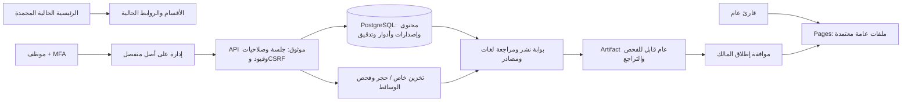
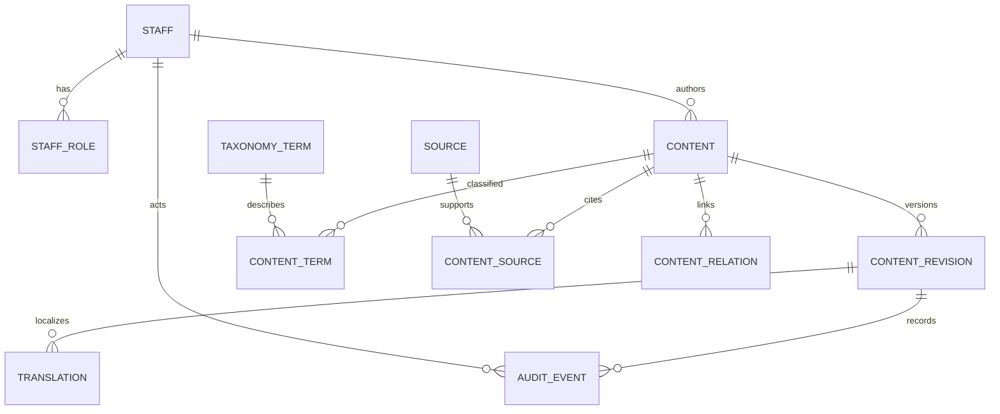

# المعمارية والعقود — الإصدار 0.1

حالة القرار: اعتماد داخلي مقترح للمراجعة، لا تفويض بإنشاء خدمات أو نشر. الصفحة الرئيسية والروابط القديمة مرجع ثابت عند commit `bf9fc51`.

## قرارات وحدود

1. **الواجهة الحالية تبقى HTML/CSS/JS**. لا React/Next أو ترحيل إطار عمل. وحدات الأقسام الجديدة ESM وأسماء CSS مستقلة. لا script أو stylesheet جديد في الرئيسية في هذا PR.
2. **PostgreSQL مصدر حقيقة مقترح**. العلاقات والمصادر والترجمات منظمة؛ JSONB يحتفظ بلقطة كاملة للإصدار لتسهيل التدقيق، ولا يحل محل فهارس التصنيف والمفاتيح الأجنبية. الاختبارات تستعمل PostgreSQL WASM محلياً، لا تخزين متصفح للإدارة.
3. **القراءة العامة منفصلة عن التحرير**. يتولى exporter موثوق فحص `publicSnapshot` ثم كتابة ملفات عامة فقط. لا تصدير للموظفين أو المراجعين أو المسودات أو المحتوى المقيد. بناء artifact ومراجعته قبل تفعيله. exporter الإنتاج لم يُربط بعد.
4. **الهوية خارج المتصفح العام**. واجهة الإدارة أصل منفصل؛ API يصدق الجلسة ثم يستعلم الأدوار من قاعدة خاصة. لا client role ولا service key في Pages. لا إصدار هوية محلي وهمي.
5. **الخدمات الخارجية تحتاج قراراً**. العقد الحالي مستقل عن Supabase أو موفر OIDC؛ لا حساب أو secret أو كلفة أو تغيير DNS.

كل ما بعد API في المخطط هو **معمارية مستهدفة**؛ المنفذ الآن نواة السياسات والمعاملات والمخطط الاختباري، وليس خدمة إنتاج.

## نموذج النواة المنفذ في SQL

`cd.content.document` هو العقد الحالي الكامل. الأعمدة id/author/version/status تطابق الوثيقة بقيود SQL. `content_revision` و`translation` snapshots غير قابلة للتعديل أو الحذف عبر trigger. تحفظ خدمة الانتقالات نسخة وترجمات وسجل عمل داخل transaction واحد، مع قفل الصف وفحص version. جداول التصنيف والمصادر والعلاقات تعطي المفاتيح الأجنبية والفهارس؛ استيراد/إنشاء/تعديل المحتوى وربط هذه الجداول عبر API **غير منفذ بعد**، فلا يصح إعلان CMS جاهزاً.

المهاجرة فارغة من الموظفين والمحتوى الفعليين، ولا تمنح PUBLIC صلاحية على المخطط. حساب قاعدة تطبيق محدود ومنح execute/RLS وبوابة كتابة DB تُراجع مع backend لاحقاً؛ هذه النواة لا تجيز توصيل PostgreSQL مباشرة بمتصفح.

## الكيانات المؤجلة بحسب المجال

| المجال | إضافات لاحقة مرتبطة بعنصر المحتوى |
|---|---|
| الأدلة والمكتبة | claim/citation، وثيقة، مرفق، ترخيص، مصطلح ومعنى بحسب اللهجة، طبعة معيار وجهة اختصاص |
| التحرير | assignment، review_task، review_decision، source_revision، media_asset، scan_result، notification |
| التاريخ | historical_event، فترة، وثيقة أرشيفية، تاريخ دقيق/نطاق/تقريبي ودرجة يقين؛ لا إجبار تاريخ قديم على timestamp حديث |
| المؤسسات | organization، unit، center، service، approved_contact، publication؛ بيانات محلية معلقة دون وثيقة |
| المعدات | equipment، model، part، hotspot، inspection_reference، compatibility؛ لا افتراض جرد محلي |
| الأكاديمية | learning_path، lesson، quiz، question، scenario، scenario_step؛ حفظ تقدم شخصي اختياري بعد موافقة وسياسة احتفاظ |
| الأطلس | dataset، license، geographic_area، aggregate_observation، verification؛ لا خرائط عمليات أو مواقع حساسة |
| الأخبار | event، news_release، occurred_at، published_at، correction، archive_entry |

تضاف بجداول ومهاجرات صغيرة، ولا يُنشأ هذا كله قبل توفر بيانات ووظائف تستعمله.

## العقد الرباعي والبحث

معرّف المصطلح ثابت، والعرض متعدد اللغات مستقل. `hazards`, `stages`, `audiences`, `places` جميعها arrays. يكفي تعديل catalog مع مراجعة labels لإضافة مصطلح؛ لا تغيير لمحرك التصفية. الأبعاد الأربعة إلزامية عند النشر.

OR داخل البعد، AND بين الأبعاد ومع كلمات البحث. facet counts تطبق النص وكل الأبعاد الأخرى وتستثني البعد الذي تحسبه؛ صفر نتائج يبقى صفراً. ترتيب: تطابق العنوان ثم النص ثم ID ثابت، مع offset وlimit مقيدين. لا إظهار نتائج بلهجة أخرى تحت اسم لغة مختارة. `normalizeSearch` يعدل مفتاح البحث فقط، ولا يغير النص أو يمسح الفروق الكردية مثل ڵ/ل أو ڕ/ر. المرادفات منفصلة بحسب اللغة وتحتاج مراجعة تحريرية.

`searchRecords` للمراجعة الداخلية فقط. القراءة العامة تمر بـ`searchPublished`/`publicSnapshot` الذي يعيد التحقق من الحالة والموافقة والإصدار والمصدر والمراجعة والترجمة ووقت النشر والخصوصية. لا يوجد خيار `includeDrafts` في مسار الجمهور.

عند نمو البيانات: PostgreSQL indexes وتطبيع مفاتيح بحث محفوظة لكل ترجمة، واختبار جودة corpus باديني وسوراني مع مراجع بشري. لا نحتاج خدمة بحث مدفوعة أو embedding في النواة الحالية. لا ندعي بحثاً دلالياً من مطابقة نصية.

## عقد المحتوى والمراجعة

| الحقل | المعنى |
|---|---|
| id/kind/scope | معرف مستقر، نوع، ونطاق international/iraq/duhok |
| version | رقم منافسة تفاؤلية؛ يتغير مع كل إجراء |
| revision | إصدار النص؛ يتغير عند تعديل المحتوى ويبطل المراجعات |
| authorId/contributorIds | مؤلف ومساهمون؛ لا يمكنهم مراجعة أو اعتماد مادتهم |
| translations | badini/sorani/ar/en مستقلة: title/summary/body/review؛ لا نسخ بادينية كسورانية |
| scientificReview/localVerification | status/revision/reviewerId/reviewedAt/expiresAt؛ مستقلة وسارية للإصدار الحالي |
| sourceIds | مصادر حقيقية مع publisher/title/HTTPS URL/locator/scope/verifiedBy/verifiedAt/expiresAt |
| missingFields/sensitivity | أي نقص يمنع النشر؛ public فقط في التصدير العام |
| tags/relatedIds | التصنيف الرباعي والعلاقات؛ حذف الروابط إلى غير المسموح نشره |
| approvedBy/approvedRevision/approvedAt | اعتماد تحريري مستقل للإصدار نفسه |
| occurredAt/publishedAt | وقت الحدث المنفصل عن وقت النشر، ISO مع timezone؛ حدث بلا وقت مؤكد = null |

المصدر الدولي لا يثبت معلومة محلية. iraq/duhok يحتاجان localVerification ومصدراً من النطاق نفسه. الموافقة الآلية ليست مراجعة بشرية؛ بيانات الموقع السابق تدخل مسودات، ولا تُستنتج الموافقة من وجود رابط.

كل مصادر السلامة تحتاج locator دقيقاً وتاريخ تحقق ومراجعة دورية؛ لا تُنقل نصوص معايير مدفوعة دون حق. علوم الحرائق تفصل تصنيفات USA/EU وطبعة المعيار والولاية المختصة. الإنقاذ والإسعاف يراجعها متخصصون وفق [INSARAG](https://insarag.org/methodology/insarag-guidelines/) و[IFRC 2025](https://www.ifrc.org/document/ifrc-international-first-aid-resuscitation-and-education-guidelines-2025) ومصادر محلية معتمدة. هذه مراجع خطة التحرير، وليست اعتماداً تلقائياً لمحتوى جديد.

## واجهة API المستهدفة وحدود الإصدار

لا HTTP API منشور في هذا PR. `editorialService.execute(token, contentId, {action, expectedVersion, reason?})` دالة خادم مع adapters إلزامية؛ لا تقبل actor أو roles أو status من العميل. الموفر يصدق الهوية ويعيد subject، ثم تُقرأ الأدوار داخلياً. الإنتاج يحتاج أن لا يملك حساب التطبيق وصولاً خارج عملياته المحددة.

| العملية المستقبلية | الحماية/النتيجة |
|---|---|
| GET /public/search | snapshot معتمد فقط، limits وcache وإصدار schema |
| POST /admin/content | editor؛ مسودة فقط؛ author من الجلسة |
| PATCH /admin/content/:id | If-Match/version، تحقق fields؛ تغيير revision وإبطال الاعتمادات |
| POST /admin/content/:id/actions | انتقال مسموح فقط؛ deny self-review؛ سجل داخل transaction |
| POST /admin/reviews | دور خبير/مترجم/مراجع بحسب النوع؛ reviewer من الجلسة؛ version ومهمة مسندة |
| POST /admin/media | حجر خاص وفحص قبل أي ظهور عام |
| GET /admin/audit | auditor/admin المحدد؛ لا tokens أو تفاصيل شخصية حساسة |

الأخطاء:401 هوية مفقودة،403 منع،404 غير موجود،409 إصدار/انتقال متعارض،422 نقص اعتماد،503 dependency unavailable. توحيد سياسة404/403 لمنع استكشاف الموارد عند بناء API. الجلسات وCSRF والحدود وidempotency والتحقق الصارم لحجم DTO وتسجيل الرفض متطلبات لازمة قبل التعريض للشبكة، وليست منفذة ضمن دالة النواة.

## التاريخ حتى اليوم

نحافظ على `history.html` الحالي. امتداد لاحق موثق: جذور مكافحة النار في المدن القديمة ← تنظيم فرق الإطفاء ← حماية المدنيين في القرن العشرين ← مؤسسات الدفاع المدني العالمية ← أطر إدارة المخاطر ← العراق وإقليم كردستان ودهوك وفق وثائق رسمية ← التطورات المعتمدة اليوم. تُفصل «جذور الإطفاء» عن «تأسيس الدفاع المدني الحديث»، ولا ننسب تاريخاً محلياً من تسلسل عالمي. خط زمني ثنائي الأبعاد بفلاتر النطاق ونوع الدليل والمقارنة ووضوح درجة اليقين؛ لا صور مولدة على أنها أرشيف.

## الترحيل والتراجع

أول PR إضافات فقط. الرجوع عنه لا يتطلب تغيير الرئيسية. لا تُشغّل SQL تلقائياً في Pages أو CI على أي قاعدة خارجية. تُجرب المهاجرة على قاعدة فارغة في الاختبار. بعد اعتماد backend: نسخة احتياطية واختبار استعادة على staging، مقارنة schema/data، تطبيق migration محكومة، ثم smoke tests قبل تفعيل feature flag. التراجع الإنتاجي بخطة forward fix أو استعادة مختبرة وإعادة إصدار artifact معتمد؛ لا DROP عشوائي ولا تعديل سجل التدقيق.
